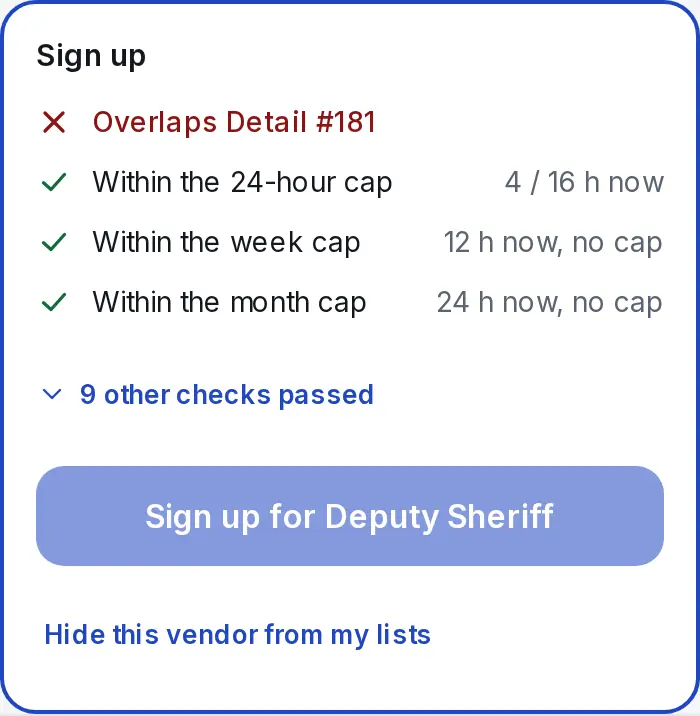
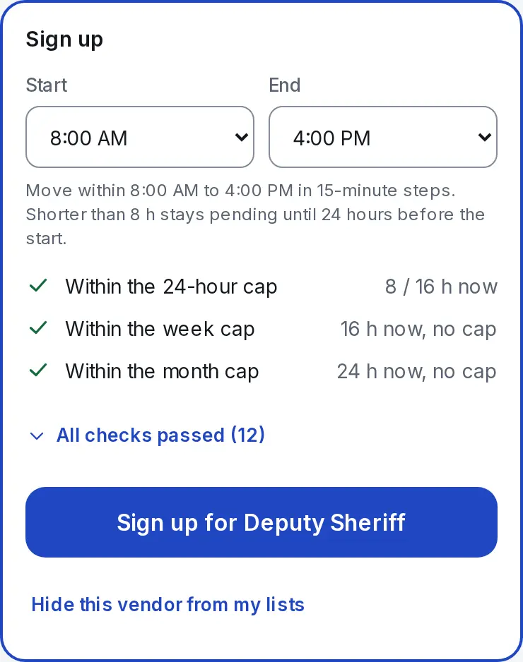
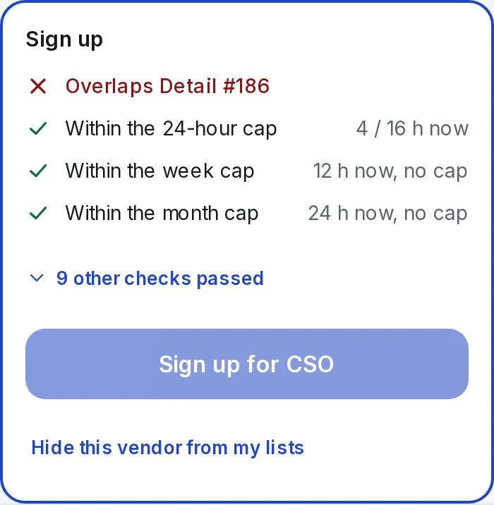

# Signing up for a detail

Sign-up is first come, first served. Extra Duty checks every rule for you and shows the result before you sign up.

1. Open the detail from **Home**, **Details** or **Map**. The **Sign up** card shows each rule with a check mark or a cross: the hour caps (any 24 hours, the week and the month), your rank, billing and more. Choose the line such as **All checks passed (12)** or **8 other checks passed** to see them all.
2. If the detail has more than one position, pick yours under **Position**. You can fill a position at your rank or below.
3. Choose **Sign up for** and the position, such as **Sign up for Deputy Sheriff**.

   

4. If a warning shows, such as officer safety information or a policy to accept, read it and choose **Accept and sign up**.

## Flexible and shorter times

Some details let you pick your own hours inside a window.

1. Pick your **Start** and **End**. The card says the window, such as "Move within 8:00 AM to 4:00 PM in 15-minute steps."
2. A shift shorter than the full detail stays pending until 24 hours before the start. If the spot is still open then, it is confirmed and you get an alert.

   

## Backups

When a detail is **Full**, choose **Join backup list**. If a spot opens, backups are offered it in order and get the alert **A backup spot is offered to you**. The detail then says **A spot is open for you. Take it before your turn ends.** Accept it before the time runs out.

> A red cross names the rule that stops you and how to clear it. See [Locks](18-locks.md).
