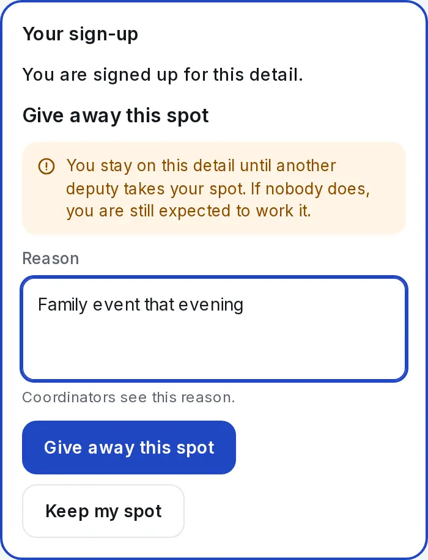

# Canceling your sign-up

You can cancel your own sign-up until the detail starts.

1. Open the detail. Find **Your sign-up**.
2. Type a **Reason for canceling**. Coordinators see this reason.
3. Choose **Cancel my sign-up**. Your spot opens for others, and backups are offered it first.

   

After a detail starts, you cannot cancel it yourself. Ask a coordinator if you need to be removed.

## When a detail you are on is canceled

If the vendor or a coordinator cancels a detail, you get an alert and the detail shows **Canceled**. It leaves **Up next** on **Home**, which lists only the details you still work. To look back at canceled and removed sign-ups, open **Details**, tick **My details only** and the **Canceled** status, and choose **Apply**; your alerts keep them too. If the vendor canceled late, inside the agency's window, you are usually paid the minimum hours. See [Late-cancel pay](15-late-cancel-pay.md).

## Who is on a detail

The roster on a detail shows the people on it now. Earlier sign-ups that were canceled are not listed.
