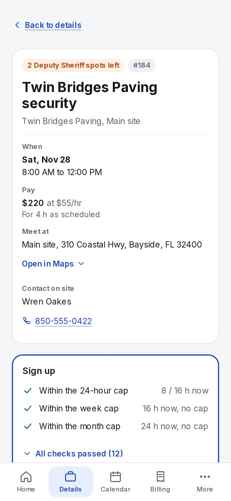

# A canceled detail that comes back

A coordinator can bring back a canceled detail before its end time, for example when the vendor's event is back on.

1. You get the alert **A canceled detail you were on is back on**.
2. Open the detail. It starts fresh, with an empty roster. Nobody is put back on it automatically.
3. If you still want to work it, sign up again as usual. It opens under the normal release rules.

   

> If you were due late-cancel pay for the canceled detail and had not billed it yet, that pay is canceled when the detail comes back.
