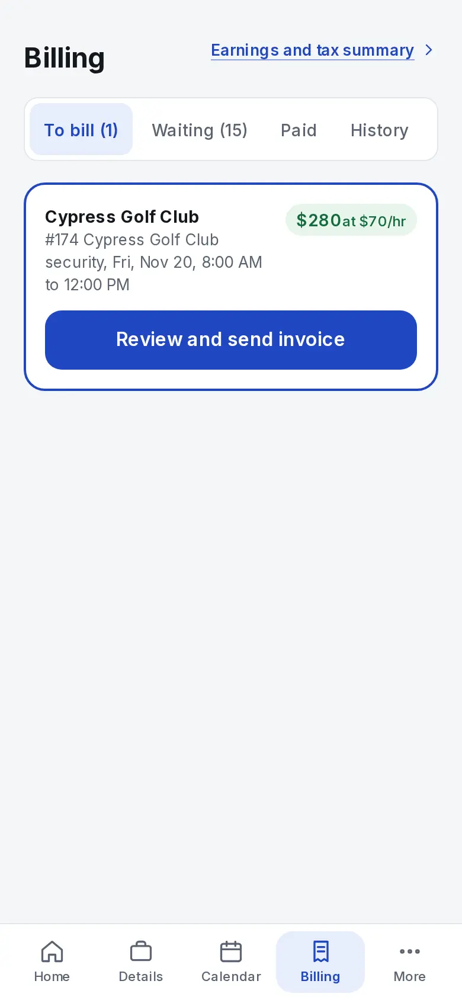
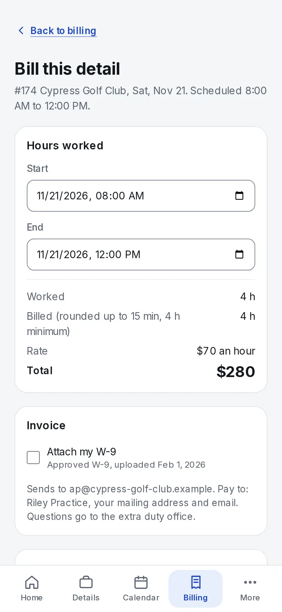
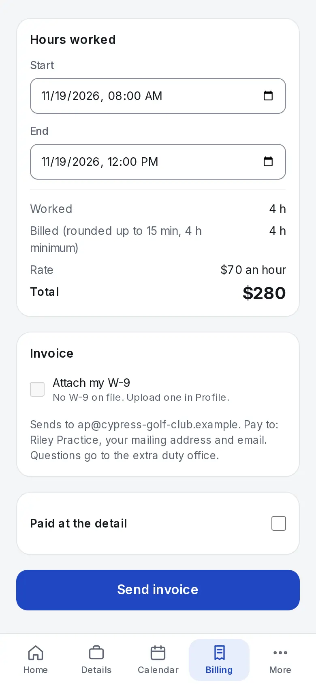
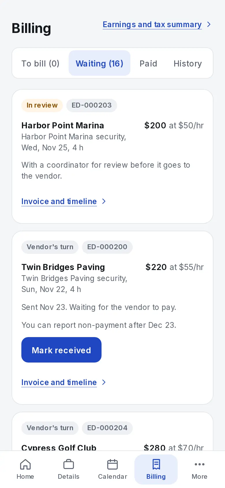

# Billing a detail

After a detail ends, you bill the vendor from Signal 90. If you bill the scheduled hours, the invoice goes straight to the vendor. If you change the hours, a coordinator reviews it first. (Your agency can also choose to review every invoice; the button on the form tells you which will happen.)

1. Open **Billing**. **To bill** lists your details that have ended. Home also shows **Ready to bill**, and a banner at the top with **Go to billing** while anything is waiting to be billed. Choose **Review and send invoice**.

   

2. Check **Hours worked**. The **Start** and **End** are filled in from the detail. **Billed** shows the hours after rounding up to 15 minutes and the 4-hour minimum, then the **Rate** and the **Total**.

   

3. If you worked different hours, change **Start** or **End**, and pick a **Reason**: **Started late**, **Ended early** or **Vendor asked me to stay**. Changed hours go to a coordinator for review, so the button reads **Submit for review** instead of **Send invoice**.
4. Under **Invoice**, tick **Attach my W-9** to send your W-9 with it. The card shows where the invoice goes and that questions go to the extra duty office.
5. If the vendor paid you at the detail, tick **Paid at the detail** and enter the **Method** and any **Check or reference number**. The vendor gets the invoice marked Paid as a receipt.

   

6. Choose **Send invoice** (or **Submit for review**). It moves to **Waiting** until you are paid. Its label there says what happened:
   - **Vendor's turn**: it went to the vendor by email.
   - **Queued to send**: your agency sends this vendor's invoices weekly or monthly, so it goes with the next batch.
   - **Approved, not sent**: this vendor does not get invoices by email, so it was approved but not sent. If the vendor pays you anyway, mark it received to close it.
   - **In review**: a coordinator checks it first, then approves it or sends it back to you. A sent-back invoice shows **Returned**; bill it again from **To bill**.

   

> Nothing can be billed before the detail's scheduled end time.
