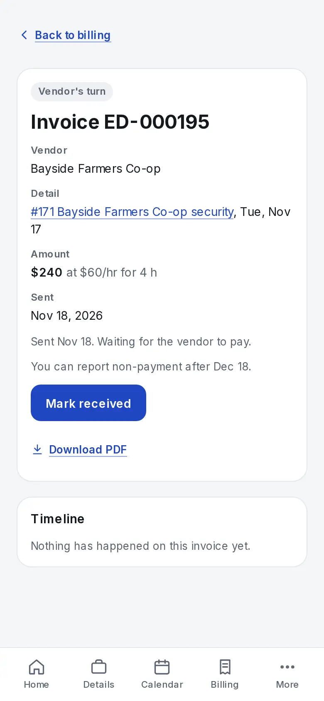

# Late-cancel pay

If the vendor cancels a detail you are on late, inside the agency's window (24 hours before the start by default), you are paid the minimum hours. The same applies when a detail is canceled because the vendor's account was put on payment hold inside that window. A coordinator can waive this pay, and you are told if they do.

1. The detail stays in **Billing**, marked **Late cancellation, paid**. Before the end time it says when you can bill it: "You can bill late-cancel pay after" the detail's end.
2. After the end time, choose **Review and send invoice**. The hours are fixed at the agency's late-cancel hours, so you cannot change them.
3. Choose **Send invoice**. It then waits for payment like any other invoice.

   

> Late-cancel pay can be billed only after the detail's scheduled end time. If a coordinator brings the detail back before then, the late-cancel pay is canceled.
