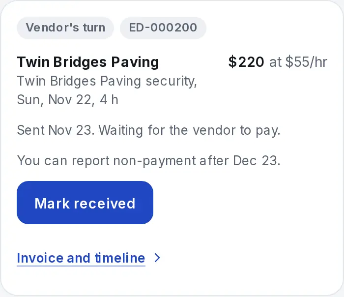
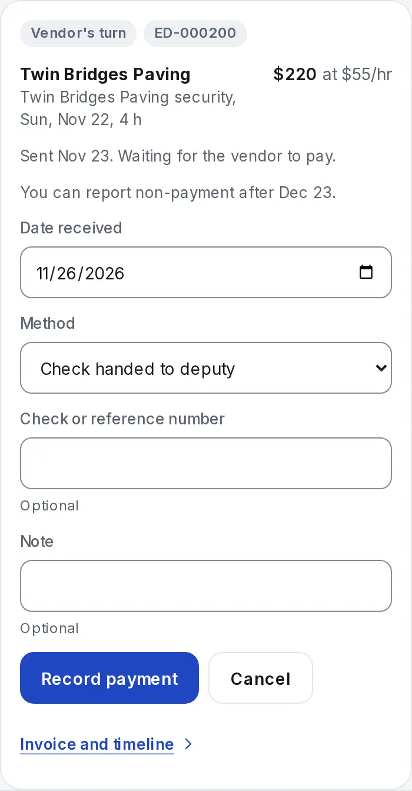

# Marking an invoice paid

Mark an invoice received when the money reaches you. Your confirmation closes the invoice as paid; the vendor does not need to mark it too. A coordinator can also close it.

1. Open **Billing** and choose **Waiting**. Each invoice shows whose turn it is, such as **Vendor's turn**, and what happens next. **Invoice and timeline** opens the full invoice.

   

2. Choose **Mark received**. Enter the **Date received**, the **Method** and an optional **Check or reference number** and **Note**.
3. Choose **Record payment**. **Cancel** closes the form without saving.
4. Where the invoice goes next:
   - It closes now and moves to the **Paid** tab, whether or not the vendor has marked it paid. No reminders, deadlines or locks follow.
   - An invoice marked **Approved, not sent** closes the same way.
   - The vendor may still mark it paid later for their own records. That shows on the timeline; you need to do nothing.

   

## When the vendor says they paid

The vendor can mark an invoice paid on their side. You get the alert **A vendor reports paying you**. Confirm it with **Mark received** when the money arrives. If you do not confirm within the agency's limit (30 days by default), your sign-ups lock until you mark it received, or report that it never arrived. See [Locks](18-locks.md).
