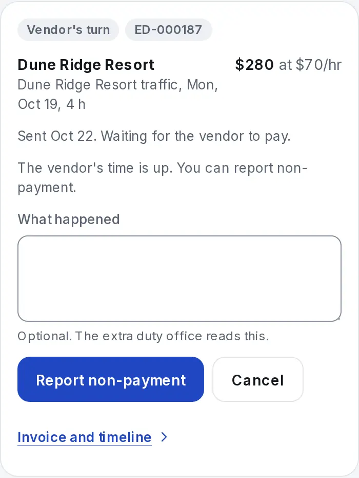

# Reporting non-payment

If a vendor has not paid, tell the extra duty office. They take it from there.

1. Open **Billing**, then **Waiting**, and find the invoice.
2. Each invoice says when you can report it, such as "You can report non-payment after Dec 22." Once the vendor's time is up, choose **Report non-payment**. If the vendor says they paid but nothing arrived, the button reads **Never arrived**.
3. Describe **What happened** if you like (the extra duty office reads it), then choose **Report non-payment** again. **Cancel** closes the form.

   

The invoice then shows a payment issue with a full timeline. Each step says who must act next: you, a coordinator or the vendor. You get an alert when it needs you. Notes on each step are optional.
