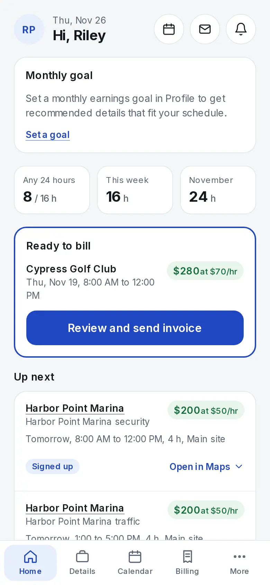
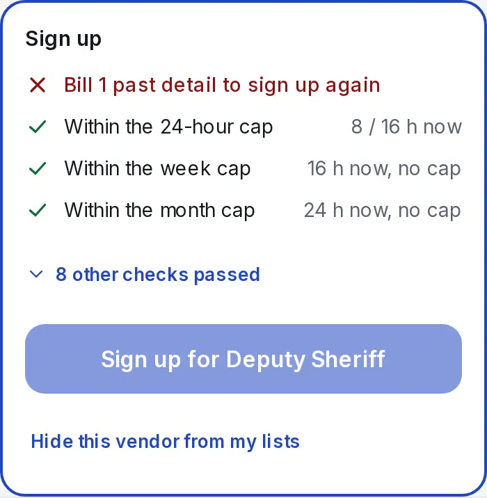

# Locks and how to clear them

A lock stops new sign-ups until you catch up on billing or your W-9. It never removes you from details you are already on.

1. **Unbilled details.** If a past detail is not billed in time, the **Sign up** card shows a red cross, such as **Bill 1 past detail to sign up again**. Home shows the detail under **Ready to bill**.

   

2. **Unconfirmed payments.** If a vendor reported paying you and you did not confirm it in time, the card says to confirm payment first.
3. **W-9.** Without an approved W-9, the card says "Your W-9 needs to be approved before you can sign up". After a requested renewal's due date it says, for example, "A new W-9 was due Jan 31". Upload one in Profile; the lock lifts once a coordinator approves it. See [Your profile and W-9](03-profile-and-w9.md).
4. To clear a billing lock, do what the cross says: bill the detail ([Billing a detail](14-billing-a-detail.md)) or mark the payment received ([Marking an invoice paid](16-marking-paid.md)). The lock lifts straight away.

   

> If something outside your control causes a lock, ask a coordinator. Coordinators can lift a lock.
