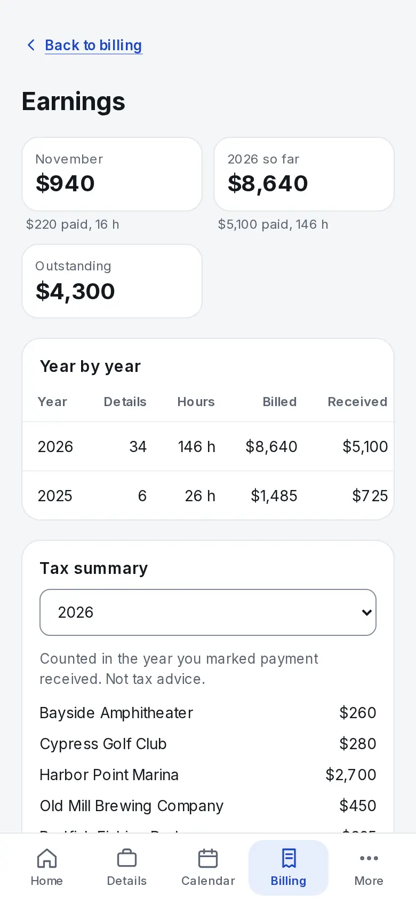
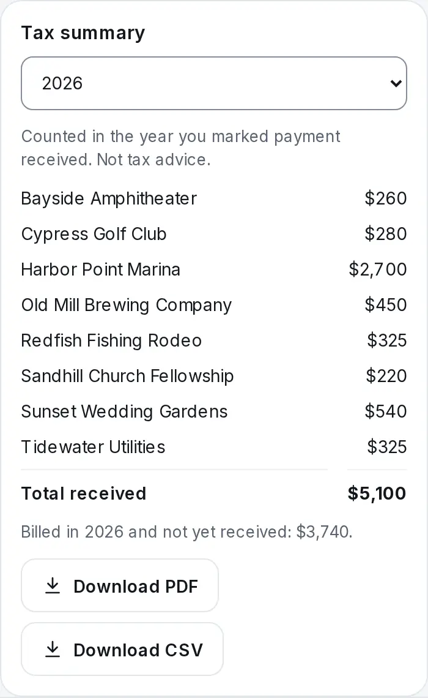

# Earnings and tax summary

1. Open **Billing** and choose **Earnings and tax summary**. The top shows this month, the year so far and what is still outstanding. **Year by year** totals your details, hours, billed and received.

   

2. Under **Tax summary**, pick the **Tax year**. Payments count in the year you marked them received, by vendor, with the total received.
3. Choose **Download PDF** or **Download CSV** for your records or your tax preparer.

   

**Billing**, **History** also lists every invoice and has **Download CSV**.

> The tax summary is a record of payments, not tax advice.
