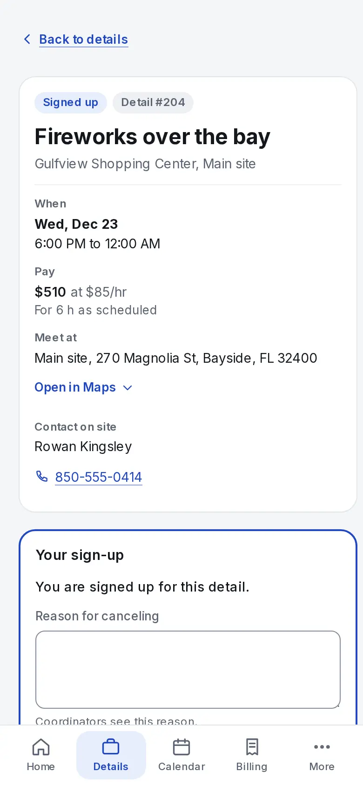
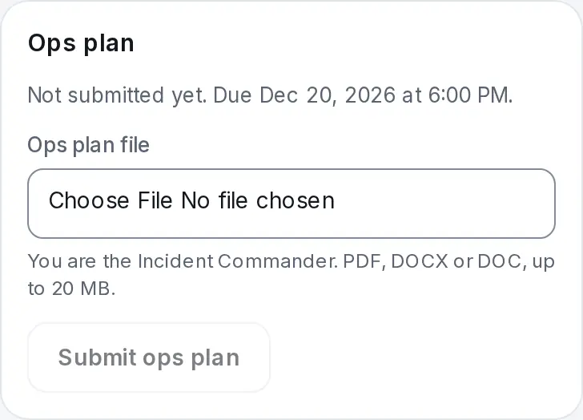

# Ops plans as Incident Commander

Some details need an operations plan. When you sign up as the **Incident Commander**, you submit it.

1. Open the detail. The pay shows your own position's pay. An Incident Commander often earns more, such as "$510 at $85/hr" where others get $60 an hour.

   

2. Find the **Ops plan** card. It says the status and when it is due (72 hours before the start by default).
3. Under **Ops plan file**, choose your plan. It must be a PDF, DOCX or DOC, up to 20 MB.
4. Choose **Submit ops plan**. A coordinator reviews it and agrees or denies it. If it is denied, submit a new version with **Submit new version**.

   

You get the alert **An ops plan is due** as the deadline nears.
