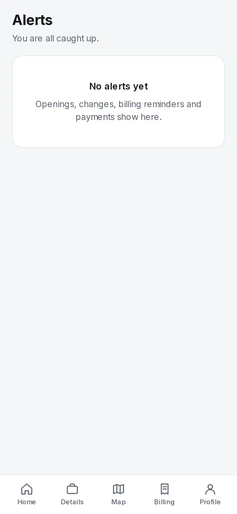
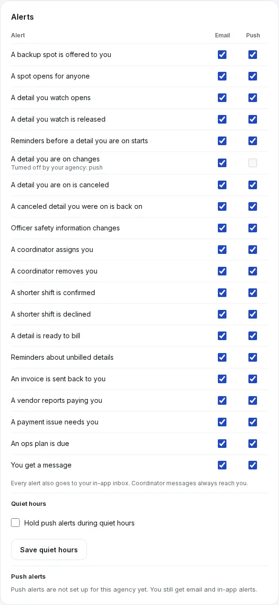

# Alerts and your alert choices

1. Choose the bell to open **Alerts**. Openings, changes, billing reminders and payments show here.

   

2. To choose how you are told, open **Profile** and find **Alerts**. Each alert has an **Email** and a **Push** box. Untick the ones you do not want.

   

3. Some boxes are greyed out with **Turned off by your agency**. The agency switched that channel off for everyone, so your choice cannot turn it on. Your own choices still apply to everything else.
4. Under **Quiet hours**, tick **Hold push alerts during quiet hours** and set the times. Choose **Save quiet hours**.
5. Under **Push alerts**, turn on push for this phone or computer. Do this once on each device.

Every alert also goes to your in-app inbox, whatever you choose. Coordinator messages always reach you.
