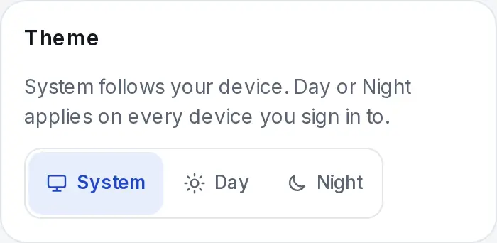

# Day and night theme

1. Open **Profile** and find **Theme**.
2. Choose **System** to follow your device, or **Day** or **Night**. Day or Night applies on every device you sign in to.

   

3. On a computer, the same switch is in the top bar.

   

> Night is easier on the eyes in a dark car. Everything works the same in both themes.
