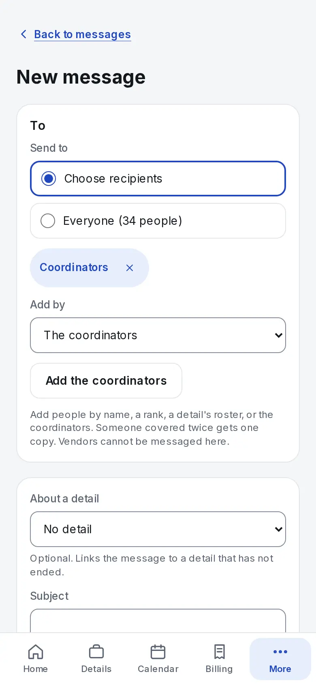

# Messages

Messages are for people inside the agency: deputies, coordinators and admins. Vendors cannot be messaged here.

## Writing a message

1. Open **Messages** (on a phone, **More**, then **Messages**) and choose **New message**.
2. Under **Send to**, choose **Choose recipients** or, where your agency allows it, **Everyone**. **Everyone** shows how many people that is.
3. With **Choose recipients**, pick how to add people, then add them:
   - **People by name**: start typing a name and choose **Add**.
   - **Everyone with a rank**.
   - **A detail's roster**: everyone signed up, waiting on a shorter shift or backing up on one of your details. The same rule as **About a detail** applies: only a detail you are signed up for, waiting on or offered a spot on, that has not ended.
   - **The coordinators**.

   Each one shows as a chip. Choose the cross on a chip to remove it. Someone covered twice, for example by name and by rank, still gets one copy.

   

4. Switching to **Everyone** replaces the chips with everyone. A note says how many recipients were replaced, with **Undo** to bring them back.
5. **About a detail** is optional. It links the message to a detail you are signed up for, waiting on or offered a spot on, that has not ended. Past details are never offered.
6. Enter the **Subject** and **Message**, then choose **Send message**.

## Reading and replying

New messages show a dot in **Messages** and an alert, by push unless you change it in **Profile**, **Alerts**. Messages from coordinators always arrive by email and push. Open a message to read it, then choose **Reply**. Your reply goes to the sender, and you can add more people.
