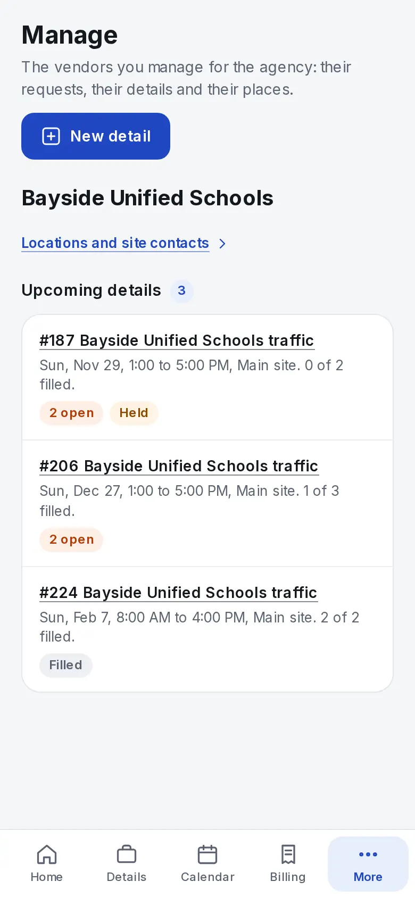
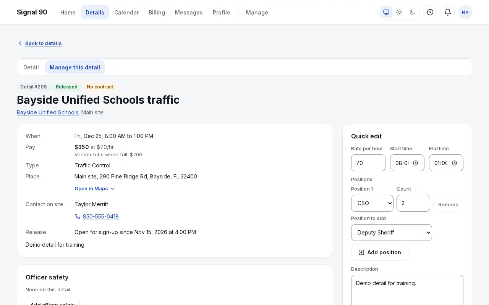

# Managing vendors

Your agency may make you the manager of a few vendors, such as the schools you cover. You keep every deputy tab, and for those vendors only you also handle their details, as a coordinator would. A coordinator or admin chooses the vendors on your account.

## The Manage tab

Open **Manage** (on a phone, **More**, then **Manage**). Each of your vendors shows its **Requests to decide** and its **Upcoming details** for the next 120 days, with how many spots are filled and whether a detail is held or has a change the vendor asked for. Choose **Locations and site contacts** to add, edit or deactivate the vendor's locations and contacts.

On **Details** and **Calendar**, your vendors' details show **Manage**.

## Creating a detail

1. On **Manage** or **Details**, choose **New detail**. Only your vendors are offered.
2. Fill in the place, title, times, rate and description. The rate must be inside the agency range; only a coordinator can approve an exception.
3. Under **Positions**, choose who can sign up: **School Resource Deputy** for people with that flag only, or **Deputy Sheriff** for everyone eligible.
4. Tick **Hold** to keep it off the open lists until you release it. Choose the dates and **Create detail**.

## Managing a detail

Open one of your vendors' details and choose **Manage this detail**. There you can:

- Edit it, or use **Quick edit** for the rate, times, description and positions.
- **Hold**, **Release** or **Release now**.
- **Assign someone** or **Remove** a person. When the placement breaks a rule, such as an overlap or an hour cap, you see the rules and can assign anyway with a reason, as a coordinator does.
- See the sign-up history, approve or decline the vendor's requests and changes, attach a contract, and copy or repeat the detail.
- **Cancel detail** or **Reactivate**, with a reason.

You get the alerts coordinators get about your vendors' details, such as a new request. To choose email or push for them, open **Profile** and find **Alerts**. Everything you do is kept in the audit log under your name. You do not see W-9s, other people's payments, other vendors, staff reports or **Management**.
