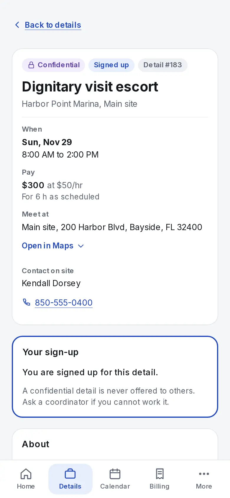

# Confidential details

Some details, such as VIP or dignitary protection, are **Confidential**. Only coordinators, admins and the people assigned can see them. Nobody signs up for one: a coordinator assigns you.

1. When you are assigned, you get an alert. Emails and phone alerts say only "You were assigned to a confidential detail on" and the date.
2. Open Signal 90. The detail is under **My details** on **Details**, **Calendar** and **Home**, marked **Confidential** with a lock. It shows in full in the app.

   

3. After you work it, bill it as usual.

Your personal calendar feed shows it as "Confidential detail" with the times only, and your earnings and tax summary list it as "Confidential detail". Every time you open it, Signal 90 logs that you did, for the coordinators.
