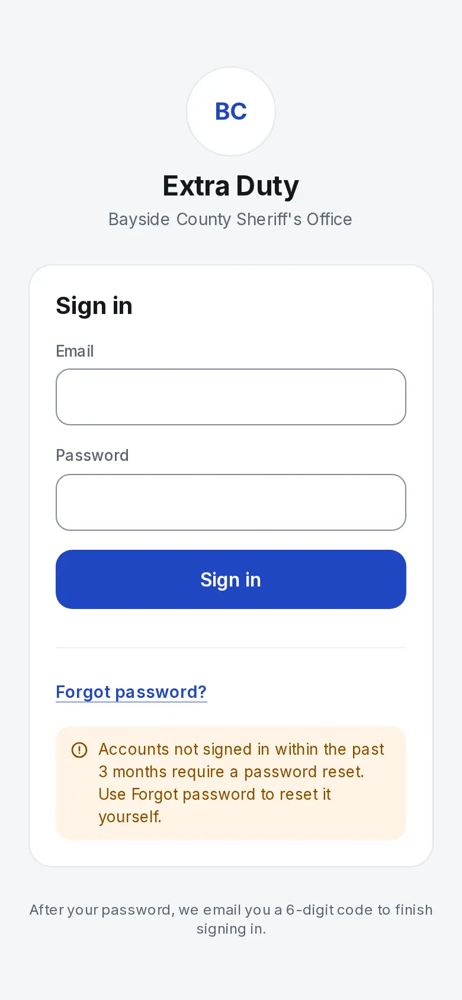

# Signing in

The agency sends you an invite email. Use its link to set your password. After that, you sign in with your password and a 6-digit code that is emailed to you each time.

1. Open the Extra Duty site. Enter your **Email** and **Password**, then choose **Sign in**.

   

2. Check your email for the 6-digit code. Type it in **Code** and choose **Verify**.
3. On your own computer or phone, tick **Trust this device for 30 days** first, so you are not asked for a code on it for 30 days.

## If something goes wrong

- No code arrived: choose **Send a new code**. Codes expire after 15 minutes.
- Forgot your password: choose **Forgot password?** and follow the email.
- Your invite link expired: ask the coordinators to send a new invite.

## Help

This manual is in the app. On a computer, choose the question mark in the top bar. On a phone, open **More** and choose **Help**.
