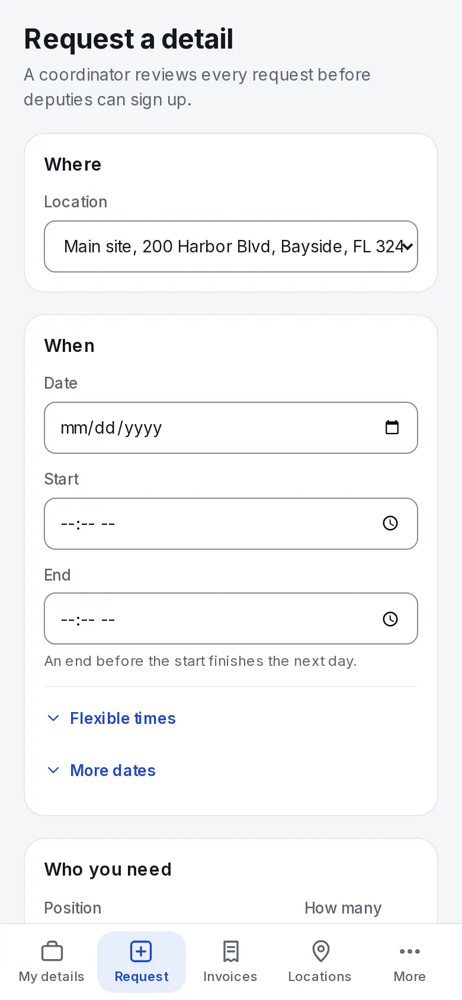
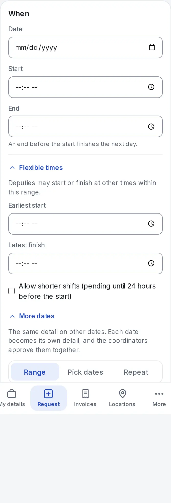
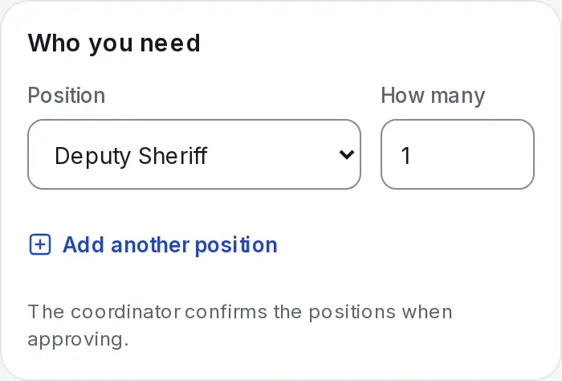
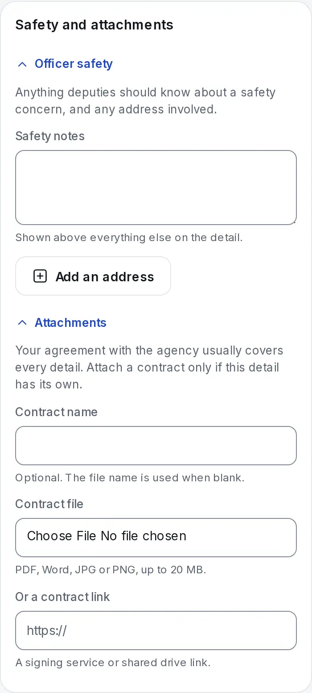

# Requesting a detail

Ask for deputies for one date or several. A coordinator reviews every request before deputies can sign up.

1. Choose **Request a detail** (**Request** on a phone). Under **Where**, pick the **Location**. To use a new place, choose **Add a new location** and type its address.

   

2. Under **When**, enter the **Date**, **Start** and **End**. An end before the start finishes the next day.
3. If deputies may come and go at other times, open **Flexible times** and enter the **Earliest start** and **Latest finish**. Tick **Allow shorter shifts** if a deputy may work only part of it. A shorter shift stays pending until 24 hours before the start.
4. For the same detail on more dates, open **More dates**. Choose **Range** for every day between two dates, **Pick dates** for chosen days, or **Repeat** for a weekly or monthly pattern. Each date becomes its own detail, and the coordinators approve them together.

   

5. Under **Who you need**, pick the **Position** and **How many**. Choose **Add another position** for a mix, such as one Deputy Sheriff and two CSOs. The coordinator confirms the positions when approving.

   

6. Under **About the detail**, give it a short **Title**, pick the **Detail type**, and describe **What the deputies will do**: where to check in, who to report to and anything they should know.
7. If there is a safety concern, open **Officer safety**. Type the **Safety notes** and choose **Add an address** for any address involved. Deputies see this above everything else on the detail.
8. Your agreement with the agency usually covers every detail. If this detail has its own contract, open **Attachments** and attach the **Contract file** or paste **Or a contract link**.

   

9. Choose **Send request**. It shows under **Waiting for approval** in **My details** until a coordinator decides.

> Requests need some notice. If the date is very close, call the coordinators.
