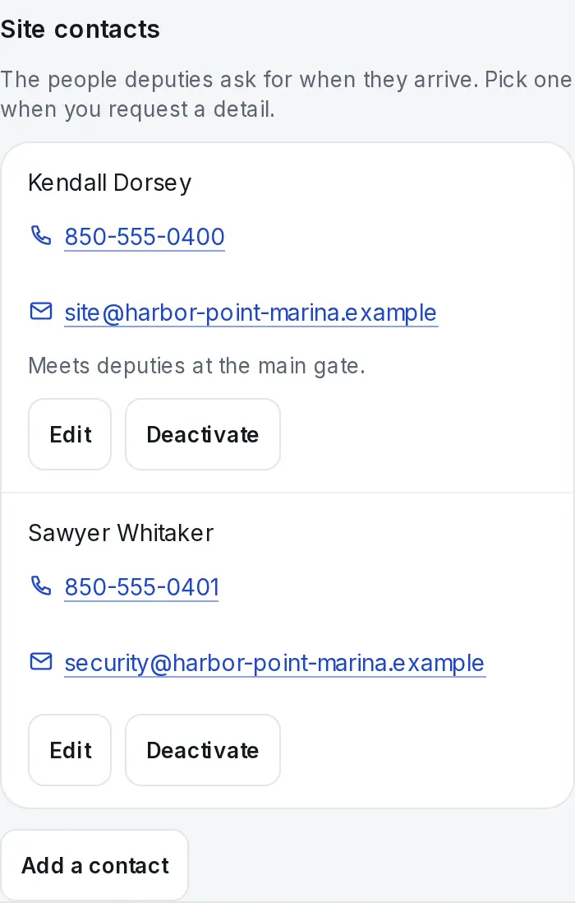
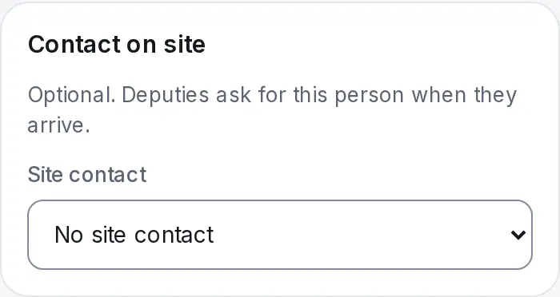

# Site contacts

Site contacts are the people deputies ask for when they arrive. Keep a list so you can pick one on each request.

1. Open **Locations**. The **Site contacts** list is below your locations.
2. Choose **Add a contact**. Enter the name, a 10-digit phone number (###-###-####) and an email. Add a note if it helps, such as "Meets deputies at the main gate."
3. Choose **Edit** to change a contact, or **Deactivate** when the person leaves. Contacts are never deleted.

   

4. When you request a detail, pick the person under **Contact on site**. Their phone number fills in for the deputies.

   
