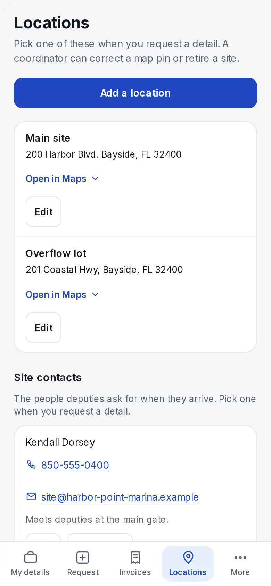
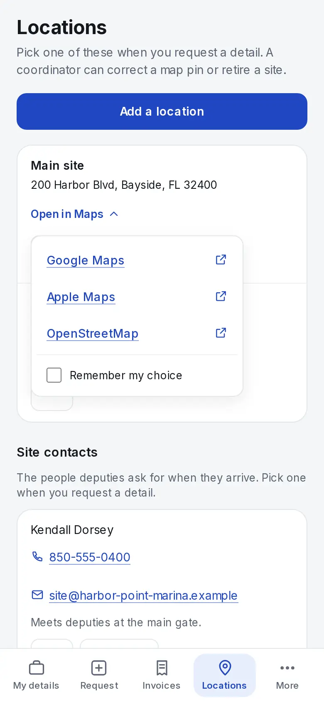

# Locations and map links

Your locations are the places you pick from when you request a detail.

1. Open **Locations**. Each place shows its address and an **Open in Maps** link.

   

2. Choose **Add a location**. Give it a name and the street, city and ZIP. The address is checked on the map. If it offers **Did you mean**, pick the suggestion or keep your own text.
3. Choose **Edit** to fix a name or address. A coordinator can correct a map pin or retire a site.
4. **Open in Maps** offers **Google Maps**, **Apple Maps** and **OpenStreetMap**. Tick **Remember my choice** to skip the menu next time.

   
