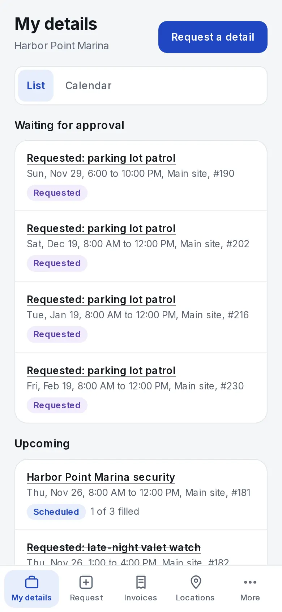
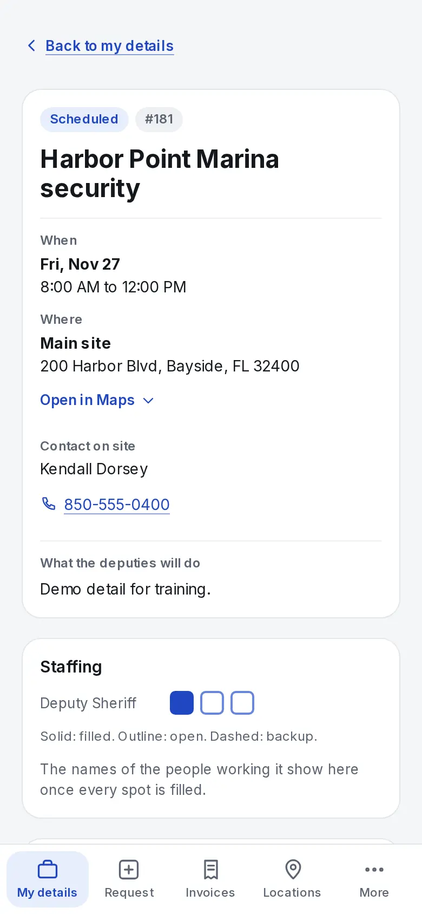

# Your details

1. Open **My details**. Your details are grouped as **Waiting for approval**, **Upcoming** and **Past 60 days**. Each shows its status, such as Requested, Scheduled, Filled, Declined or Canceled, and how many spots are filled. Choose **Calendar** to see them by month.

   

2. Choose a detail to open it. You see the time, place, contact on site, what the deputies will do and the staffing. The names of the people working it show once every spot is filled.

   
