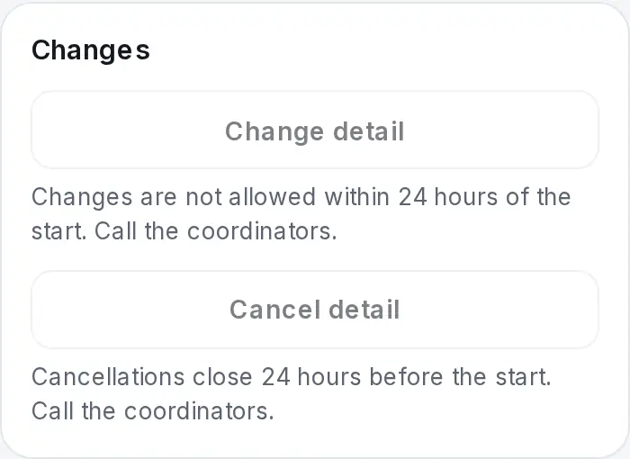
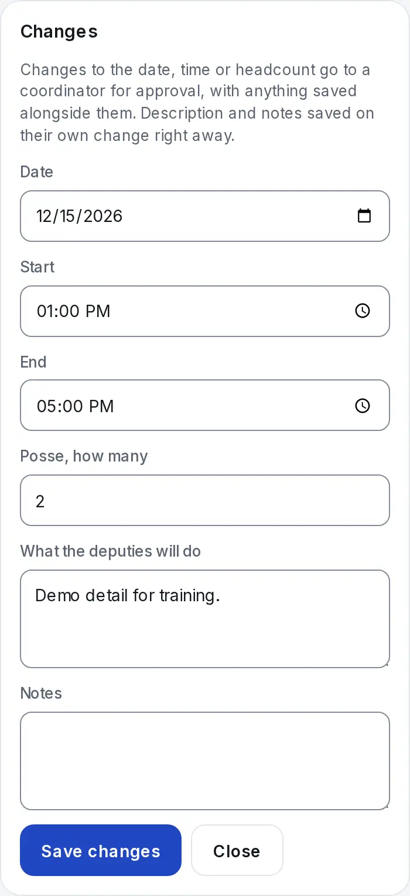

# Changing or canceling a detail

What you can change depends on how close the detail is and whether anyone has signed up. The **Changes** card on each detail says what you can do now.

1. Open the detail from **My details** and find **Changes**.

   

2. To change it, choose **Change detail**. Edit the **Date**, **Start**, **End**, how many of each position, **What the deputies will do** or **Notes**, then choose **Save changes**.
   - The description and notes change right away.
   - Changes to the date, time or headcount go to a coordinator for approval.

   

3. To cancel it, choose **Cancel detail**, give the **Reason for cancelling**, and choose **Confirm cancellation**. The coordinators and the people signed up see the reason.

## The limits

- **Before a coordinator approves:** change the request as much as you like, or choose **Withdraw request**.
- **Once someone is signed up:** you cannot change the detail. Call the coordinators. (Your agency may allow adding positions; the page says so.)
- **Within 24 hours of the start:** no changes. Call the coordinators.
- **Canceling:** you can cancel until 24 hours before the start. After that, call the coordinators. A cancellation that late is usually paid to the deputies at the minimum hours.
- **After it starts:** it cannot be changed or canceled.
- **Payment hold:** if your account is on payment hold, upcoming details are locked until the hold is resolved.

These hours are your agency's settings and may differ. The **Changes** card always shows the rule that applies.
