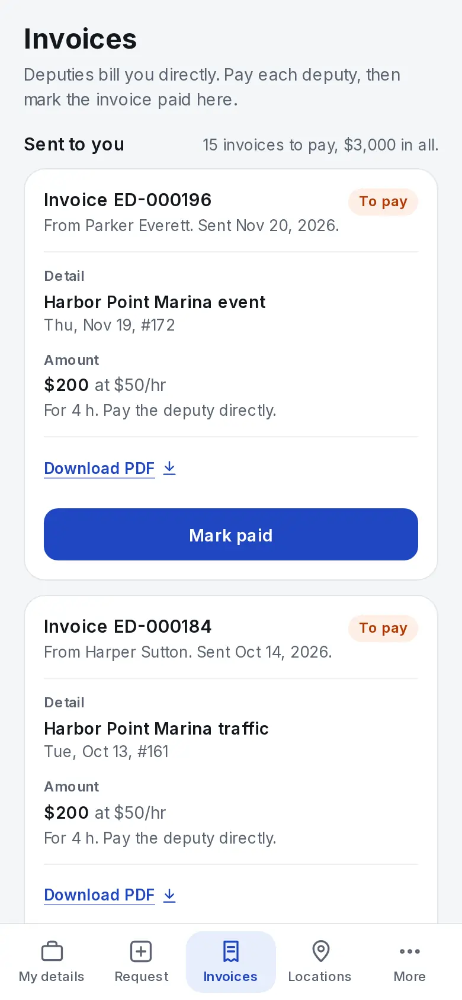
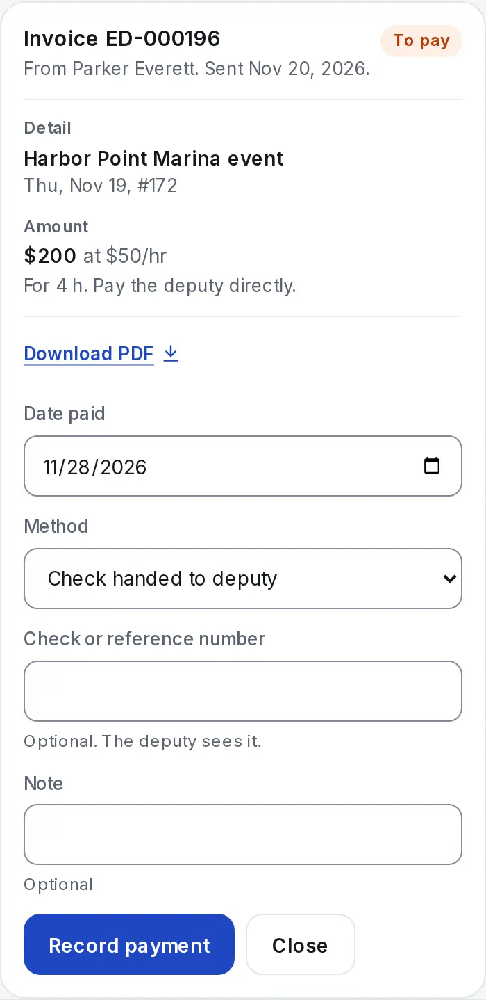
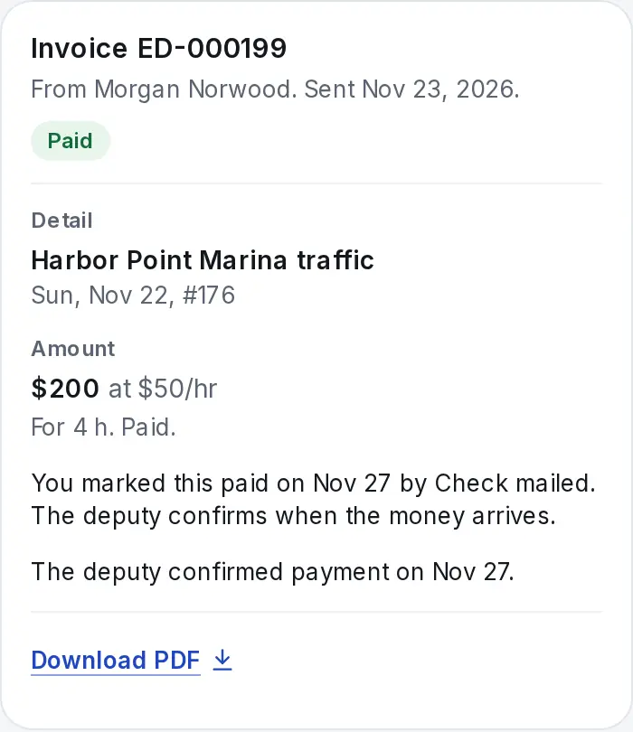

# Invoices and marking them paid

Deputies bill you directly after each detail. The agency never handles the money. Pay each deputy, then mark the invoice paid.

1. Open **Invoices**. **Sent to you** lists the invoices to pay and the total. Each card shows the deputy, the detail and the amount. A detail the agency keeps confidential is named "Confidential detail" here and is not listed under your details. Pay the deputy directly, by the address on the invoice.

   

2. After you pay, choose **Mark paid** on that invoice. Enter the **Date paid**, the **Method** and an optional **Check or reference number** and **Note**. The deputy sees them. Choose **Record payment**.

   

3. Every invoice stays on the page, so you have a record. Each card has a label:
   - **To pay**: not paid yet.
   - **You marked paid**: you recorded payment and the deputy has not confirmed it yet.
   - **Paid**: settled. The card says when the deputy confirmed payment. Once the deputy confirms, nothing more is needed from you; you may still choose **Mark paid** for your own records. An invoice the deputy was paid for on the spot arrives already marked **Paid**, with $0.00 due.
   - **Closed**: the agency closed it without payment.

   

## Good to know

- You see an invoice only once it is sent to you. An invoice still in review, approved but not sent, or waiting for a weekly or monthly batch is not shown.
- Some agencies send invoices in a weekly or monthly batch, with a cover sheet that totals the batch.
- Questions about an invoice go to the extra duty office, not the deputy.
