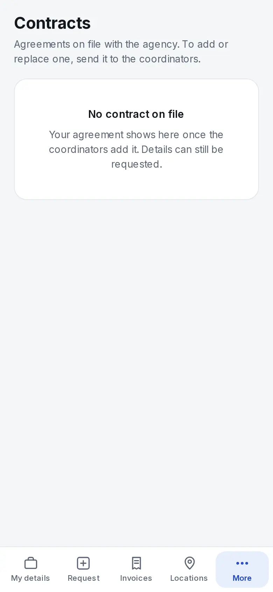

# Downloading contracts and invoices

1. Open **Contracts** (under **More** on a phone). Your agreements with the agency are listed. Choose one to download it. To add or replace a contract, send it to the coordinators.

   

2. To download an invoice, open **Invoices** and choose **Download PDF** on that invoice.
3. A contract attached to a single detail shows on that detail under **Contract**.
